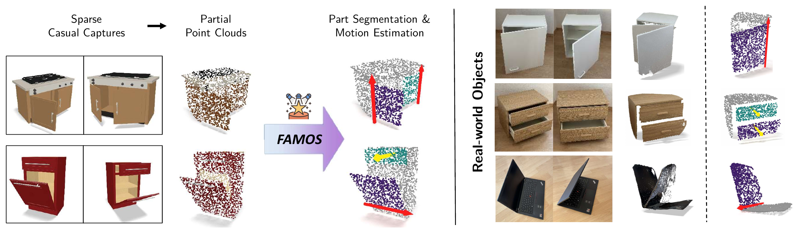
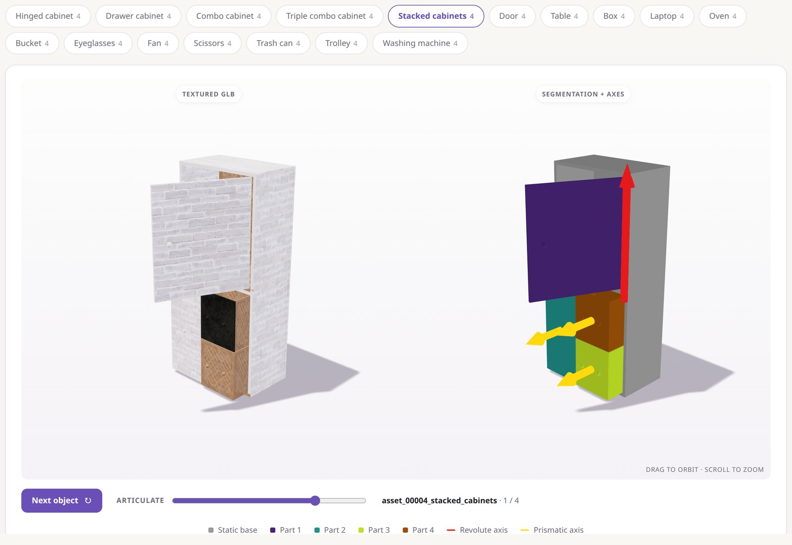

<p align="center">
  <h2 align="center"> FAMOS: Feed-Forward 3D Articulation Modeling from Sparse Observations </h2>
  <p align="center">
    <a href="https://kevinqu7.github.io/">Kevin Qu</a><sup>1,2</sup>,
    <a href="https://taosun.io/">Tao Sun</a><sup>1</sup>,
    <a href="https://www.linkedin.com/in/massimiliano-viola/">Massimiliano Viola</a><sup>1</sup>,
    <a href="https://www.zhuliyuan.net/">Liyuan Zhu</a><sup>1</sup>,
    <a href="https://www.zhiz.dev/">Zhizhuo Zhou</a><sup>1</sup>,
    <a href="https://sayands.github.io/">Sayan Deb Sarkar</a><sup>1</sup>,
    <a href="https://scholar.google.com/citations?user=FZuNgqIAAAAJ&hl=en">Konrad Schindler</a><sup>2</sup>,
    <a href="https://ir0.github.io/">Iro Armeni</a><sup>1</sup>
  </p>
  <p align="center">
    <sup>1</sup>Stanford University &nbsp;&nbsp;&nbsp;&nbsp;&nbsp;&nbsp;&nbsp;&nbsp; <sup>2</sup>ETH Zurich
  </p>
</p>

<p align="center">
  <a href="https://arxiv.org/abs/2609.20817">
    
  </a>
  <a href="https://kevinqu7.github.io/famos">
    
  </a>
  <a href="https://huggingface.co/kevinqu7/famos-model">
    
  </a>
</p>

<p align="center">
We present FAMOS, a feed-forward model that predicts movable-part segmentation and joint parameters from a sparse set of partial point clouds.
</p>

<p align="center">
  
</p>

## ⚙️ Setup

The code has been tested with:
- Ubuntu 24.04.4 LTS, Python 3.10, PyTorch 2.8.0+cu128 (CUDA 12.8), NVIDIA GeForce RTX 5090.

### 1. Clone the repository

```bash
git clone https://github.com/GradientSpaces/FAMOS.git
cd FAMOS
```

### 2. Create the conda environment

```bash
conda env create -f environment.yml
conda activate famos

# Build pytorch3d from source (needs the CUDA 12.8 toolkit, ~10 min)
CUDA_HOME=/usr/local/cuda-12.8 FORCE_CUDA=1 \
    pip install --no-build-isolation "git+https://github.com/facebookresearch/pytorch3d.git@V0.7.8"
```

### 3. Set up PartField

FAMOS uses a frozen [PartField](https://github.com/nv-tlabs/PartField) encoder. To download the PartField checkpoint:

```bash
mkdir -p checkpoints
wget https://huggingface.co/mikaelaangel/partfield-ckpt/resolve/main/model_objaverse.ckpt \
    -O checkpoints/model_objaverse.ckpt
```

## 📥 Model Weights

The FAMOS model weights can be found on Hugging Face
[here](https://huggingface.co/kevinqu7/famos-model). You can also download them using
this command:

```bash
# Download model weights from Hugging Face
hf download kevinqu7/famos-model famos.safetensors --local-dir checkpoints
```

## ✨ Demo

Run FAMOS on some example real-world captures and synthetic benchmark objects, which we provide in the [`demo/`](demo) directory:

```bash
python predict.py input_dir=demo/real_world   # real-world iPhone captures
python predict.py input_dir=demo/benchmark    # PartNet-Mobility, ACD, and ArtiCraft objects
```

Each object comes with its input views, object masks, and reconstruction. For real-world captures, we segmented the object in each photo with [SAM2](https://github.com/facebookresearch/sam2) and used [VGGT-Ω](https://github.com/facebookresearch/vggt-omega) to obtain the partial point clouds. Results are saved to
`outputs/demo/`.

## 📸 Run on Your Own Photos

To run FAMOS on your own photos, please refer to the [step-by-step guide](demo/README.md) which walks you through the process.

## 📂 Data Preparation

To pre-process the data for training and evaluation, please follow these [instructions](dataset_process/README.md).

## 📈 Evaluation on Benchmarks

Set the checkpoint paths and dataset root:

```bash
export FAMOS_CHECKPOINT=checkpoints/famos.safetensors   # path to the FAMOS model checkpoint
export PARTFIELD_CHECKPOINT=checkpoints/model_objaverse.ckpt # path to the PartField encoder checkpoint
export FAMOS_DATA_ROOT=data                             # directory containing the datasets
```

Then launch inference and evaluation:

```bash
bash scripts/eval/eval_partnet_mobility.sh
bash scripts/eval/eval_acd.sh
bash scripts/eval/eval_articraft.sh
```

The first argument sets the number of input states (default S=2), e.g.
`bash scripts/eval/eval_acd.sh 2`. Metrics are written to
`results/states_<S>/famos/<dataset>_eval/`.

We report movable-part segmentation (precision, recall, F1 at IoU 0.5) and a cumulative
motion F1: `M` (correct joint type), `MA` (+ axis error < 5°), and `MAO` (+ origin error
< 0.05 of the object scale). By default, predictions are scored on the first input state. To match and
score the parts jointly over all input states instead, add `model.eval_all_states=true`, e.g.
`bash scripts/eval/eval_acd.sh 2 model.eval_all_states=true`.

After evaluating the benchmarks, you can summarize all `metrics.json` files under `results/` into one
table:

```bash
python scripts/eval/summarize.py
```

We also report `#`, the number of matched moving parts; `AE`, the mean axis error in degrees; and `OE`, the
mean origin error of revolute joints relative to the object scale.

To inspect individual predictions, add `model.export_visualizations=true`. This saves one image
per object to `results/states_<S>/famos/visualization/<dataset>/<object_id>.png`.
Moving parts are colored by part, the static base is grey, and joint axes are drawn as red
(revolute) or yellow (prismatic) arrows.

```bash
bash scripts/eval/eval_acd.sh 2 model.export_visualizations=true
```

## 🏋️ Training

Training was conducted on 4×A100 (40GB) GPUs. The scripts use all visible GPUs and adjust
gradient accumulation to keep the effective batch size of 128, so they also run on fewer GPUs. Training settings are in
[`config/trainer/train.yaml`](config/trainer/train.yaml) and the data mixtures in
[`config/data/stage1.yaml`](config/data/stage1.yaml) and
[`config/data/stage2.yaml`](config/data/stage2.yaml).

```bash
export FAMOS_DATA_ROOT=data
export PARTFIELD_CHECKPOINT=checkpoints/model_objaverse.ckpt

# Stage 1: 50k steps on procedurally generated objects only
bash scripts/train/train_stage1.sh

# Stage 2: 80k steps on a 1:1 mixture of procedural and dataset (PartNet-Mobility, GRScenes) objects
export FAMOS_STAGE1_CHECKPOINT=outputs/famos_stage1/last.ckpt
bash scripts/train/train_stage2.sh
```

Checkpoints are written to `outputs/famos_{stage1,stage2}/`, and training resumes automatically from `last.ckpt`. Runs are
logged to the W&B project `famos` (run `wandb login`).

## 🧩 Procedural Asset Generator

The generated synthetic training assets come from our procedural generator in
[`generate_procedural_data/`](generate_procedural_data/). It builds articulated objects from 17
families (listed below) from simple primitives such as boxes, cylinders, and panels, so exact
part segmentation and joint parameters are known by construction. The commands below export
complete objects as URDF + textured GLB files.

<p align="center">
  
</p>

<details>
<summary><b>Object families</b></summary>

| Family | Variants |
| --- | --- |
| `hinged_cabinet` | Front door (hinged at top, bottom, left, or right), top lid, or side door; top- and bottom-hinged doors single or split in two |
| `drawer_cabinet` | 1–4 drawers |
| `combo_cabinet` | 2 bays, each with hinged doors or 1–4 drawers |
| `triple_combo_cabinet` | 3 bays, each with hinged doors or drawers |
| `stacked_cabinets` | Two cabinets of the same size stacked on top of each other |
| `door` | Single swing (left or right hinge), double swing, sliding, sliding up |
| `table` | Drop leaf (single left/right, or double), drawer, fold-up top |
| `box` | Split lid, or hinged lid with a sliding inner tray |
| `laptop` | Laptop (hinged screen), or book (left or right spine) |
| `oven` | Side door (left or right hinge) or drop-down door, both with a sliding rack |
| `bucket` | Rectangular or round body; curved or straight swinging handle |
| `eyeglasses` | Rectangular or round frame with two folding arms |
| `fan` | Base, pole, and spinning blade |
| `scissors` | Two blades on a shared pivot |
| `trash_can` | Hinged lid or lift-off lid |
| `trolley` | Telescoping handle and four wheels |
| `washing_machine` | Round door hinged on the left or right |

`triple_combo_cabinet` and `stacked_cabinets` extend the 15 families described in the paper.

</details>

```bash
# 1. Download PBR materials from MatSynth (omit --limit for all)
pip install datasets
python generate_procedural_data/download_materials.py --out materials --limit 500

# 2. Generate assets (10 per object family)
python generate_procedural_data/generate.py --out procedural_assets --per_family 10 --seed 0 --materials materials

# 3. Browse them at http://localhost:8000 (remote: ssh -L 8000:localhost:8000 <host>)
python generate_procedural_data/visualize.py procedural_assets
```

Each generated asset is centered, scaled to a largest
side of 1, and written in the PartNet-Mobility format:

```text
procedural_assets/asset_00000_hinged_cabinet/
├── mobility.urdf          # kinematic tree referencing the meshes below
├── textured_objs/*.glb    # PBR-textured meshes for the static body and each movable part
├── mobility_v2.json       # joint type, axis, origin, and limits per part
├── result.json            # part hierarchy
├── manifest.json          # family, variant, and sampled dimensions
└── meta.json, bounding_box.json, texture_manifest.json
```

> Note: during training, objects are built in the dataloader on the fly as untextured meshes, without
> exporting any files. The model receives partial point clouds rendered from them with a
> virtual camera.

## ☑️ Todo List
- [x] Release model weights & evaluation code
- [x] Release training code
- [x] Release data preprocessing code
- [x] Release procedural asset generator

## 🙏 Acknowledgements

We would like to thank the following works for their valuable contributions:

- [Rectified-Point-Flow](https://github.com/GradientSpaces/Rectified-Point-Flow), [Particulate](https://github.com/ruiningli/particulate) and [PartField](https://github.com/nv-tlabs/PartField): the codebases and models our work builds upon.
- [PartNet-Mobility](https://sapien.ucsd.edu/downloads), [GRScenes](https://huggingface.co/datasets/InternRobotics/GRScenes), [ACD](https://github.com/3dlg-hcvc/s2o), and [ArtiCraft-10K](https://huggingface.co/datasets/camvsl/Articraft-10K): datasets used for training and evaluation.
- [MatSynth](https://huggingface.co/datasets/gvecchio/MatSynth): PBR materials for the procedural generator.

## 📜 License

The FAMOS code is released under the [Apache License 2.0](LICENSE.md). PartField is
subject to its own [NVIDIA license](PartField/LICENSE), and MatSynth materials to their
own licenses.

## 🎓 Citation

If you find our work useful, please consider citing:

```bibtex
@InProceedings{qu2026famos,
  title     = {FAMOS: Feed-Forward 3D Articulation Modeling from Sparse Observations},
  author    = {Qu, Kevin and Sun, Tao and Viola, Massimiliano and Zhu, Liyuan and Zhou, Zhizhuo and Sarkar, Sayan Deb and Schindler, Konrad and Armeni, Iro},
  booktitle = {Proceedings of the IEEE/CVF Winter Conference on Applications of Computer Vision (WACV)},
  year      = {2027}
}
```
