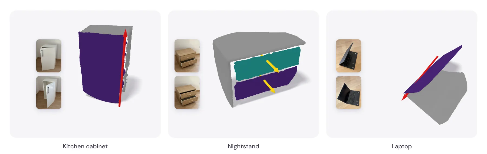

# Running FAMOS on Your Own Photos

This guide shows how to run FAMOS on your own captures. We recommend taking 2-3 photos of the object in different articulation states. We segment the object in each image with [SAM2](https://github.com/facebookresearch/sam2),
reconstruct the partial point clouds with
[VGGT-Ω](https://github.com/facebookresearch/vggt-omega), and run FAMOS on them to predict
the movable parts and their joints.

The examples below were captured with an iPhone. Each shows the input photos and the
predicted parts and joints.

<p align="center">
  
</p>

## 1. Install SAM2 and VGGT-Ω

Install both into the `famos` environment. The VGGT-Ω checkpoint requires an
[access request](https://huggingface.co/facebook/VGGT-Omega).

```bash
# SAM2 (its weights are downloaded automatically on first use)
SAM2_BUILD_CUDA=0 pip install git+https://github.com/facebookresearch/sam2.git

# VGGT-Ω and its checkpoint
pip install git+https://github.com/facebookresearch/vggt-omega.git
hf auth login
hf download facebook/VGGT-Omega vggt_omega_1b_512.pt --local-dir checkpoints
```

## 2. Take the photos

- Take one photo for each articulation state, e.g. with a drawer closed and then opened. Two
  to three photos work well.
- Between photos, move only the parts and leave the object in place.
- Save the photos in `my_object/images/` as `0.jpg`, `1.jpg`, ... The first photo defines the coordinate frame of the predictions.

## 3. Mask the object

We provide an interactive script to segment the object from the input images. For this, run:

```bash
python scripts/segment.py my_object
```

Then open http://localhost:8000 (on a remote machine, forward the port with
`ssh -L 8000:localhost:8000 <host>`). The script saves the
masks to `my_object/masks/`.

## 4. Reconstruct the point clouds

To obtain the object point cloud with VGGT-Ω, run:

```bash
python scripts/reconstruct.py my_object
```

This saves the masked reconstruction to
`my_object/reconstruction.npz`.

## 5. Run FAMOS

In the last step, do inference with the FAMOS model:

```bash
python predict.py input_dir=my_object
```

The prediction is saved to `outputs/demo/my_object/`: `prediction.json` contains the joint
type, axis, and origin of each movable part, `prediction.npz` the points with their part
labels, and `prediction.png` and `prediction.gif` visualize the result.

## Limitations

As discussed in Sec. F of the [paper](https://arxiv.org/abs/2609.20817):

- FAMOS works best on furniture and household objects similar to its training data (such as
  cabinets, doors, tables, and laptops) and might fail for out-of-distribution classes.
- Very noisy reconstructions can lead to wrong predictions.
- Very small parts are treated as static.

VGGT-Ω and its checkpoint are released under the
[FAIR Noncommercial Research License](https://github.com/facebookresearch/vggt-omega/blob/main/LICENSE),
and SAM2 under [its own license](https://github.com/facebookresearch/sam2/blob/main/LICENSE).
